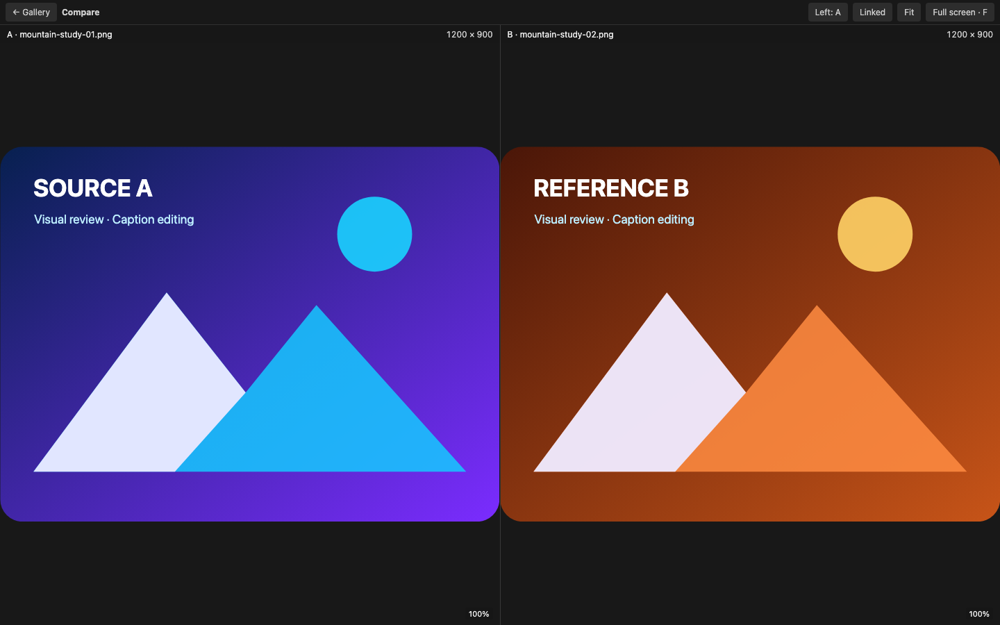
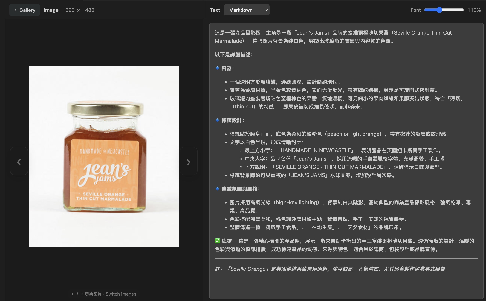
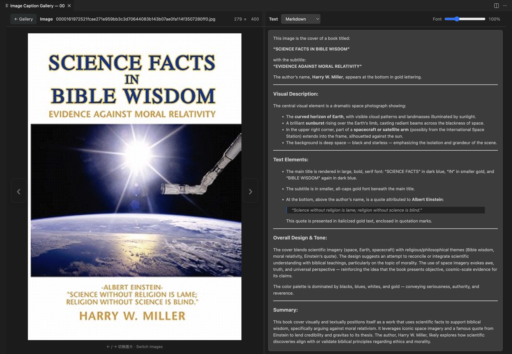
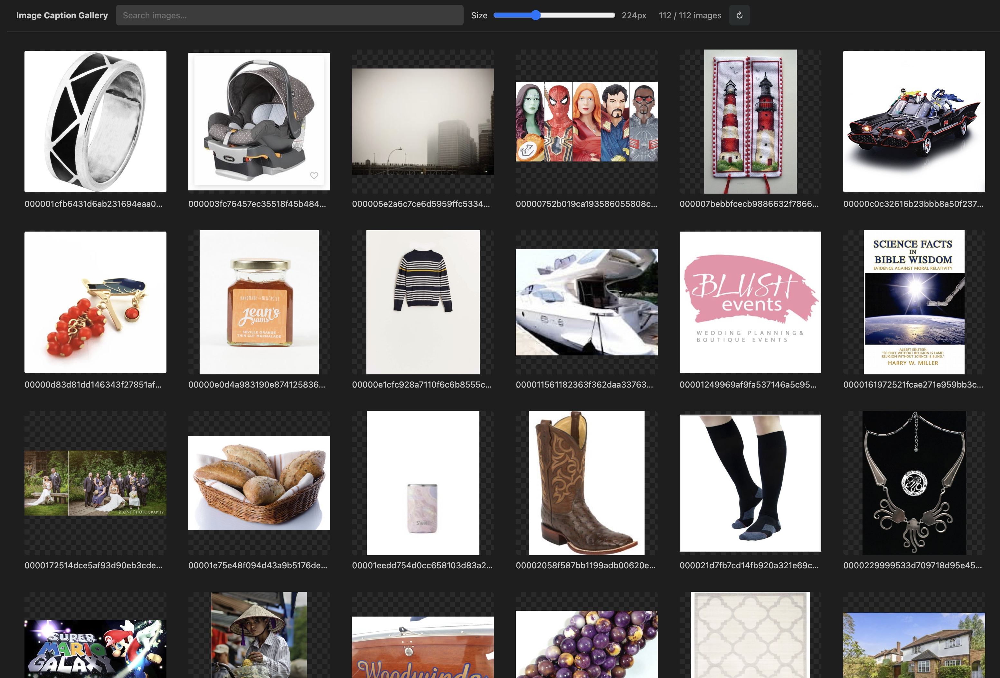

# Image Caption Gallery

[English](README.md) | [简体中文](README.zh-CN.md)

A fast, local-first VS Code extension for browsing image/video datasets, comparing images, and editing sidecar captions without leaving the editor.

**Compare image pairs with linked zoom and pan. Press `E` to edit a matching `.txt` Caption. Browse large local or Remote SSH datasets without transferring full-resolution images up front.**

## Highlights

| Two-image comparison | Caption review and editing |
| --- | --- |
| Command-click on macOS or Ctrl-click on Windows/Linux to select A and B. Compare them side by side, switch the left pane between A/B, hold `Space` for a temporary reference overlay, link zoom and pan, or continue in true browser fullscreen. | Read the same-name `.txt` beside each image or video as Markdown, plain text, or formatted JSON. Press `E` to start editing, save with `Command+S` / `Ctrl+S`, and keep drafts protected during navigation and external file changes. |

The extension also supports camera RAW, mixed image/video folders, virtualized large galleries, on-demand video playback, browser fullscreen, and host-side previews that reduce Remote SSH traffic.

## Preview

### Compare two images side by side

<p align="center">
  
</p>

### Edit a matching TXT Caption

<p align="center">
  
</p>

### Review Markdown Caption beside the image

<p align="center">
  
</p>

### Browse the whole dataset

<p align="center">
  
</p>

## Features

- Open a folder, selected image, or selected video from the Explorer context menu.
- Launch instantly with `Command+Option+G` (`⌘⌥G`) on macOS or `Ctrl+Alt+G` on Windows/Linux.
- Compare two images side by side with linked or independent zoom/pan, instant A/B switching, hold-Space reference viewing, and browser fullscreen.
- Recursively discover `.jpg`, `.jpeg`, `.png`, `.webp`, `.gif`, `.bmp`, `.avif`, and camera RAW files such as `.dng`, `.cr2`, `.cr3`, `.nef`, and `.arw`.
- Resize gallery thumbnails continuously from 96 px to 480 px.
- Search images by filename or relative path.
- Read, edit, and create same-name `.txt` sidecar Captions; press `E` in details to enter Edit mode and focus the editor.
- Render captions as Markdown by default, with Raw text and formatted JSON modes.
- Save with `Command+S` / `Ctrl+S`, or cancel with `Escape`.
- Confirm before switching images, returning to Gallery, or hiding Text when a draft is unsaved.
- Detect external file changes before saving and choose to overwrite, reload, or continue editing.
- Preserve UTF-8 BOM and LF/CRLF line endings whenever an existing caption is updated.
- Drag the center divider to resize the Image and Text panes.
- Use **Settings → Caption text** to switch between caption reading and full-width browsing.
- Keep every image fully visible without cropping, even after resizing the window or divider.
- Zoom from 25% to 800% with a trackpad pinch or `Ctrl/Command + wheel`, with faster default sensitivity and a percentage reset button in Settings.
- Pan an enlarged image by dragging or two-finger scrolling, and double-click to restore the original fitted view.
- Show the original `width × height` resolution as right-aligned values in stable four-character fields.
- Scale caption text from 70% to 180% with a compact dropdown.
- Switch images with `Left` / `Right` or the translucent image-edge controls.
- Return to the gallery with `Escape` while preserving search and thumbnail state.
- Work with local folders and VS Code Remote SSH workspaces.
- Generate proportional previews on the extension host, with a default limit of 2048² pixels, to reduce SSH image transfers.
- Open one settings drawer from either Gallery or details; full-width browsing does not load or render caption files.
- Browse MP4, WebM, MOV, AVI, MKV and other video files alongside images, with native playback, seeking, volume and fullscreen controls.
- Load only first-frame posters in the grid; stream original byte ranges or short compatibility fragments on demand in details.

Right-click (or two-finger click on a trackpad) an image/video card, media preview or filename and choose **Copy File Path**. This copies the original absolute path on its host, including the server path under Remote SSH. It also works in comparison and browser fullscreen; the left reference copy uses B’s path. Caption text keeps its normal editing menu. macOS Ctrl-click in Gallery retains its comparison-selection behavior.

## Two-image comparison

Ctrl-click (Windows/Linux) or Command-click (macOS) two **images** in Gallery. Selection order assigns A to the left and reference B to the right; both A/B markers remain visible for 350 ms after the second selection before comparison opens automatically. macOS Ctrl-click also works without a conflicting context menu. Ordinary clicks open details; videos cannot be selected for comparison.

- Click **Left: A / Left: B** in the top toolbar to switch between **A | B** and **B | B**. The right image stays fixed, with no toggle over the image divider.
- **Hold Space** to temporarily show B on the left; release it to restore the previous left-image selection. Losing focus or hiding the page clears the held key.
- Pinch or Ctrl/Command-wheel to zoom; drag or two-finger scroll to pan. Views share a fit-relative magnification and normalized center by default. Choose **Independent** to adjust each separately; double-click a pane to fit it. Aspect ratios are preserved without automatic registration or cropping.
- **Full screen** or **F** opens a private browser comparison with the current pair, preview quality and views. Click Full screen again there to enter native fullscreen. Controls hide after two idle seconds. Esc exits fullscreen and stays in the browser.
- Each pane header shows the displayed image’s original resolution; hover for its full path and original/preview dimensions.
- **Esc** in the VS Code comparison returns to Gallery with scroll and A/B selections preserved. Press **Esc** again in Gallery to clear both selections; holding the key does not clear them. Ctrl/Command-click a selected image to remove it, or use **×** to clear both. Search changes clear selection; refresh removes missing files.

Comparison never reads captions or changes the Gallery Caption preference. A, B and an independent left reference copy are decoded before switching is enabled; prepared switches need no new preview requests or decoding. All three count toward the 128 MiB decoded-image cache estimate, with unrelated entries evicted first. Explicit active originals or animations can exceed the estimate; their quality and animation are preserved. RAW and transparency use the existing host preview pipeline. Animation timing is not synchronized. Each side offers Retry / Load original on failure. Browser and panel operate independently after opening; browser sessions expire after 30 minutes of inactivity.

## Install

Install directly from the VS Code Marketplace:

```bash
code --install-extension xingfu-yi.image-caption-gallery --force
```

You can also download the latest `.vsix` from [GitHub Releases](https://github.com/Xingfu-Yi/vscode-image-caption-gallery/releases) and run **Extensions: Install from VSIX...** from the VS Code Command Palette.

When using Remote SSH, install the extension in the remote extension host. If you run the command in a remote terminal, copy the `.vsix` to the remote machine first and use its remote path.

## Usage

1. Open a folder that contains images, videos, and optional matching caption files.
2. Right-click an image, video, or folder in Explorer and select **Image Caption Gallery**. You can also select an image and press the launch shortcut.
3. Adjust the thumbnail size or search the gallery.
4. Select an image or video to open the side-by-side media and Text view.
5. Press `E` or select **Edit** to change the Caption. Use `Command+S` / `Ctrl+S` or the checkmark to save; use `Escape` or × to cancel.

If the matching `.txt` file does not exist, Edit starts with an empty draft and Save creates the file. If another program changes the caption while you are editing, Image Caption Gallery asks whether to overwrite it, reload the external version, or keep editing your draft.

### Settings and small windows

Both Gallery and details have a **Settings** button. The drawer groups Caption visibility, reading format, font size, pane layout/share, image zoom, thumbnail size, preview quality, zoom speed and video/FFmpeg options. Each option includes a label or explanation. The detail toolbar shows the file name and original dimensions, plus preview dimensions when resized, alongside Back, Edit and Settings. Display preferences remain in the drawer.

The detail toolbar also has a **Caption** shortcut (`C`) for images and videos. Turn it off to let the media fill the available width; turn it on to load the latest matching text. Drafts retain Save / Discard / Continue protection.

Changes apply immediately and are remembered for the current Gallery, without editing workspace settings. **VS Code default settings…** opens the extension's settings to change defaults for new galleries. For SSH, FFmpeg paths refer to the server. Labels follow the VS Code display language (English or Chinese).

**Auto** layout places text below the image below 680 px. You can also force side-by-side or stacked panes. The settings drawer scrolls independently and fills narrow screens. Escape closes Settings and returns focus to its button; it does not leave the current media. Caption edits keep the existing Save / Discard / Continue protection. Opening settings preserves video playback; changes to video compatibility prepare a new video source.

### Preview resolution and image-only browsing

Configure these values in VS Code Settings, or add them to `settings.json`:

```json
{
  "imageCaptionGallery.maxPreviewResolution": 2048,
  "imageCaptionGallery.showCaption": true,
  "imageCaptionGallery.zoomSensitivity": 5
}
```

`maxPreviewResolution` is a **total pixel budget**, not a maximum side length: the preview's width × height stays at or below the value squared. A 4096 × 4096 image becomes 2048 × 2048, while a 4000 × 1000 image remains unchanged. Images are never enlarged, cropped, or overwritten. Set the value to `0` to load originals in details; grid thumbnails remain small. Resolution changes also update open galleries without discarding caption drafts.

For Remote SSH, previews are generated **on the remote extension host** before being transferred to the client. Small thumbnails and detail previews use separate cache entries. A bounded CPU decoder pool prioritizes queued detail images and only requests thumbnails near the viewport. The disk cache uses a 256 MiB LRU budget; files currently in use remain protected, so active images can temporarily exceed that budget. The detail header shows oriented original and preview dimensions beneath the filename, without opening Settings. Settings also retains the dimensions; hover for additional preview information.

Image decoding defaults to **multiple reusable processes** on the extension host, including the server under Remote SSH. In **Settings → Image decoder execution / Parallel image decoders**, choose processes or Worker threads and automatic or manual parallelism. Both use multiple CPU cores; processes isolate crashes, while threads avoid IPC copies and can be faster. `imageCaptionGallery.previewExecutionMode` defaults to `"process"` (`"thread"` is also supported); `imageCaptionGallery.previewConcurrency` defaults to `0`, automatically selecting 1–4 from CPU and free-memory budgets (~512 MiB per decoder). Manual 1–8 is capped by CPU count and total memory. More decoders reduce waiting across images; they do not split a single RAW development across cores or accelerate network reads. GPU is not used. The drawer applies these settings to all galleries in the current host session; the VS Code defaults button saves machine/remote defaults through the normal settings editor. Existing work finishes when changing modes/counts; unowned work is cancelled, and idle decoders exit after 30 seconds. Unsupported process startup falls back to threads.

**Settings → Current image preparation** separates host queue, source read, decode/resize/encode (including decoder startup when cold), cache writing, resource loading and browser decoding. **Switch to paint** measures the current navigation separately from any earlier resource preparation. JPEGs use scaled decoding when shrinking; RAW uses adequate embedded previews before full sensor development.

Once the current request enters the host queue, Gallery prepares **one image on each side**, overlapping idle decoder work with transfer and browser decoding. Adopting an in-flight neighbour also starts the next neighbour immediately. Foreground images outrank neighbours, which outrank grid thumbnails. Ready images reuse the decoded element; recently viewed images remain in a maximum **seven-entry, estimated 128 MiB decoded-memory LRU**, with the current image protected. Oversized originals/animations stay on demand; neighbours above 64 MiB estimated RGBA are not retained speculatively. A cached target thumbnail or a labelled previous frame stays visible during a slow switch; a loading indicator appears only after 150 ms. First visits and navigation faster than preloading can still need preparation.

Captions are prefetched only while visible, displayed independently of image loading and revalidated without overwriting edits. Image modification time/size and preview settings invalidate cached previews. Unused in-flight work is cancelled on rapid navigation; hidden panels and leaving details release neighbours/history. Videos remain on demand.

Oversized images are encoded as WebP previews at quality 85, retaining transparency and GIF/WebP animation. Detail images within the budget use their original files. If preview generation fails or exceeds its resource limits, select **Load original** in the detail view. This fallback is explicit to avoid an unexpected full-size transfer. A bundled WASM32 ImageMagick runtime handles processing without requiring image tools on the server.

Set `showCaption` to `false` to open new galleries in full-width image-only mode. Open **Settings** from either toolbar and use **Caption text → Caption: On / Off** to change the current gallery. Hiding captions stops caption loading and rendering; showing Text reads the current image's latest caption. The choice is remembered for that gallery and does not modify workspace settings. New galleries use the configured default. Unsaved caption edits still require Save, Discard, or Continue Editing before hiding Text.

### Large folders

The gallery renders only visible rows plus a small buffer. Scrolling recycles cards and releases images outside that window; opening a detail or hiding the panel releases grid resources. Only four thumbnail requests can be loading at once. Search covers the entire discovered dataset with a short debounce, and returning from details preserves the gallery's scroll position. Arrow keys, Home/End, and Tab continue through files outside the rendered window.

Grid thumbnails use a separate **static WebP capped at 512² total pixels**, or a lower `maxPreviewResolution` value. Small images are never enlarged. Animated thumbnails show the first frame; animations still play in details. Setting `maxPreviewResolution` to `0` disables the **detail** size limit; grid thumbnails remain small to bound transfer and decoded memory use. Source images remain unchanged.

Directory discovery sends metadata in batches of up to 512 records, so large folders can be browsed while scanning continues. Closing or refreshing a gallery cancels its previous scan. Cache hits and scrolling no longer sort the entire preview cache on each release.

JPEG grid thumbnails use scaled decoding, avoiding full-size pixel buffers before resizing. Camera metadata is removed from thumbnails while ICC color profiles are retained. Small WebP thumbnails (up to 256 KiB) are sent in the existing response, avoiding another Remote SSH resource request. The scheduler prioritizes the visible viewport, keeps 4–16 requests in flight according to decoder capacity, and uses one visibility scheduler. Failed or stalled images release their slots, and hover details separate host queue/processing from message and browser display time. Cached previews remain reusable after reopening or restarting. Large PNGs use a bounded 384 MiB pixel cache; automatic process counts reserve about 768 MiB per decoder for pixel caches, WASM and input buffers.

For repeatable measurements, run `npm run benchmark:thumbnails -- /path/to/folder 12` after installing development dependencies. It measures cold, warm and restart cache performance without changing source files; generation timings exclude SSH transfer and browser rendering. `node test/serveGalleryHarness.cjs` runs the real extension pipeline against 287 generated large JPEGs for browser/scrolling QA.

### Camera RAW and zoom sensitivity

Camera RAW previews are prepared on the extension host. For TIFF-based camera containers with a correctly oriented embedded JPEG large enough for the requested pixel budget, Gallery reuses that camera-rendered preview and decodes close to the target size. Small previews are never enlarged to replace the requested quality. Missing, unsupported, damaged or aspect-mismatched embedded previews fall back to the bundled LibRaw decoder, using camera white balance and sRGB output. Original-resolution requests always use full RAW decoding. Supported suffixes include `.dng`, `.cr2`, `.cr3`, `.crw`, `.nef`, `.nrw`, `.arw`, `.raf`, `.orf`, `.rw2`, `.pef`, `.srw`, and other LibRaw camera containers. Camera models and compression variants depend on the bundled decoder. Headerless scientific/sensor `.raw` dumps require separate layout metadata and are not supported.

RAW images are **always converted to a browser-readable preview**, including when they are below the pixel limit or `maxPreviewResolution` is `0`. For RAW, **Load original** requests a full-resolution decoded image; it does not send the unreadable sensor container directly to the browser. Source files remain unchanged.

`zoomSensitivity` ranges from `0.5` to `10`, defaulting to `5`: small pinch gestures respond five times faster than in 0.2.0. Set it to `1` for the previous response. Changes take effect in open galleries. Wheel pixel/line/page units are normalized and individual steps are capped to avoid sudden jumps. Settings shows the zoom percentage and a zoom slider; click the percentage or double-click the image to return to the fitted view. Plain two-finger scrolling still pans an enlarged image.

### Full-screen image browsing

Open an image and click **Full screen** in the detail toolbar, or press **F**. The button keeps its text on narrow screens. In the browser, click **View full screen** (or press **F**) to enter native fullscreen: only the image and any necessary black borders remain, without VS Code or browser chrome. This second user gesture is required by the browser. Landscape and portrait images fit completely, preserving their aspect ratio without cropping. **← / →** switches images without leaving fullscreen; **Home / End** jumps to the first/last image. Touch swipes also work. The toolbar, arrows and cursor hide after two idle seconds and reappear on interaction; **Esc** exits fullscreen and stays in the browser. Double-click toggles fullscreen in the browser; Gallery double-click still resets image zoom.

**Settings → Images → Full-screen image browsing** opens the current image, or the first image in Gallery's current search results. The browser follows that image order and skips videos. It never reads captions; Caption visibility and unsaved edits stay in Gallery. The viewer uses the preview quality chosen when opened, including original-resolution mode and RAW decoding. To use a different preview quality, change it in Gallery and open a new viewer.

Adjacent images are generated on the host, transferred and decoded before navigation. The browser keeps up to seven images within a 128 MiB estimated decoded-memory budget, protects the displayed image and checks file versions in the background. Oversized originals/animations load on demand instead of speculative downloads; source quality and animation behavior are preserved. Cold images can still take time to process or transfer. SSH uses the existing private forwarding service; closing Gallery keeps the browser session alive, while disconnecting SSH or closing VS Code stops it. Sessions expire after 30 inactive minutes.

### Browser Gallery navigation

The independent browser image, video and comparison views include a **Gallery** control. It leaves native fullscreen when necessary and switches the same browser tab to the mixed image/video result set that was active when the viewer opened. The browser Gallery remembers its own search, scroll position and selected file; click a card to return to an image viewer or video player. Returning from video retains its position, selected quality, speed, volume and mute state. Press **F** to show the browser Gallery itself in native fullscreen.

The browser grid is virtualized, so a large folder keeps only visible rows and a small overscan in the DOM. Its list endpoint sends metadata pages only. At most four visible thumbnails are requested at once; leaving the viewport cancels unused work. Image cards use small static previews, while video cards request only a cached first-frame poster—never a hidden player or whole-video conversion. Right-click / trackpad secondary-click still copies the original host path. Browser Gallery does not request Caption files or touch unsaved Caption drafts. It uses the same random, expiring private session and Remote SSH forwarding as the fullscreen viewer.

### Video browsing


MP4, WebM, MOV, M4V, AVI, MKV, MPG/MPEG, WMV, 3GP, MTS/M2TS, OGV, VOB and FLV appear alongside images. Scanning reads file records only. A visible video card requests a small JPEG of its **first frame**, with a play icon and format badge; it never loads a video into the grid. Poster generation needs FFmpeg and is cached. Small JPEGs travel directly in the result message, avoiding a second Remote SSH resource fetch; only Gallery’s visibility scheduler controls loading. Cards show preparation or failure status instead of waiting silently. Hover a ready thumbnail for cache status, byte size, host queue/extraction time and approximate message/display overhead. Refresh retries failures.

Videos start paused and use native playback, full-timeline seeking and volume controls. Press Space when the detail view has focus to play/pause; focused player shortcuts remain native. Videos share TXT captions and the Caption toggle with images. Switching files releases the source and cancels unused requests. Hiding the Gallery pauses playback and compatibility requests; opening Settings preserves playback.

**Full screen** in the video toolbar (`F`, or double-click) opens a separate browser player, retaining the current position, quality, speed, volume and mute state. Gallery pauses after the browser opens successfully. In the browser, click **Continue and full screen**: browsers require this additional user gesture for actual fullscreen. Controls hide after two seconds of idle playback and reappear on interaction. Escape leaves fullscreen in the browser; Gallery does not resume automatically. Caption drafts stay in Gallery.

VS Code disables native HTML video fullscreen in extension webviews ([upstream issue](https://github.com/microsoft/vscode/issues/165073)). **Settings → Video → Viewing area → Fill panel** keeps playback inside Gallery, temporarily hides Caption and restores its previous layout on Escape. It remains distinct from browser fullscreen and does not change VS Code layout settings.

The browser reads supported originals with byte ranges, including H.264/AAC MP4/MOV. Scaling or compatibility uses bundled **HLS.js 1.7.3** and only requested **four-second H.264/AAC MPEG-TS fragments**; no CDN or whole-file conversion is required. FFmpeg needs `libx264` and AAC encoders for this browser path; Gallery compatibility uses VP8/Vorbis. The private loopback endpoint is forwarded through Remote SSH. Browser sessions survive closing Gallery and expire after 30 minutes without activity; closing VS Code or disconnecting SSH stops the stream.

Gallery serializes SourceBuffer updates, rejects aborted/closed operations and ignores obsolete seek results. A compatible stream gets one automatic rebuild at the same position/state. Persistent errors offer original playback below the picture; concrete media codes, fragment indices and timing are available in **Output → Image Caption Gallery · Video**.

**Settings → Video → Playback speed** offers 0.25×–4×. Changes apply immediately without reloading, and persist for this Gallery across seeking and video switches. Native player speed changes are reflected in Settings too.

Playback reads the requested part of the remote file, without first preparing a complete video:

- **Compatible originals:** HTTP byte-range requests read the required bytes. Open-ended ranges are capped at 4 MiB per response. Seeking lets the browser request the corresponding position directly.
- **Compatibility playback:** `imageCaptionGallery.videoCompatibility` defaults to `"auto"`. FFprobe reads codec/duration metadata; incompatible files use MediaSource with **four-second VP8/Vorbis WebM fragments**, generated by FFmpeg on the extension host only when requested. Opening a paused detail prepares only the current fragment. During playback, two in-flight requests overlap host processing and SSH transfer, while MediaSource appends remain serial. Forward buffering targets about 20 seconds of viewing time, scales with playback speed up to 48 seconds of media, and respects an encoded-data budget (32 MiB appended in Gallery, plus at most two 16 MiB in-flight fragments). The browser player adjusts its window from observed fragment sizes. Seeking requests the selected fragment directly and cancels obsolete work. No intervening fragments or full-length compatibility copy are prepared.

For example, AAC audio is not supported by VS Code's webview, so H.264/AAC MP4 uses compatibility fragments. See [VS Code's supported media formats](https://code.visualstudio.com/api/extension-guides/webview#supported-media-formats). **Convert with FFmpeg** also uses short fragments. **Play original video** lets you try native playback if compatibility processing fails. Seeking into an uncached fragment can still briefly wait for server decoding and transfer.

The player offers **Original, 2K, 1080p and 720p** below the picture. **The default is the lower of source resolution and 2K**, with no upscaling. 2K means up to 2560 × 1440; 1080p is 1920 × 1080 and 720p is 1280 × 720. Portrait swaps the bounds; other aspect ratios fit proportionally. Use **Settings → Video quality** or `imageCaptionGallery.videoPreviewMaxHeight`: `0` is Original, `1440` is 2K (default), with `1080` and `720` also available. Original preserves source resolution; incompatible video/audio still uses short on-demand fragments. Codec-compatible originals above the chosen quality also use only requested fragments, reducing CPU and SSH traffic without preparing the whole file. Explicit native-only playback bypasses quality limits; selecting a quality restores Auto.

Quality changes retain position, speed, volume and paused/playing state, and preserve Caption drafts. Each Gallery retains its own selection; new galleries use VS Code defaults, without writing workspace settings from UI changes. Legacy Gallery preview defaults migrate to the new configured default; legacy 480/2160 configuration values map to 720p/2K. The header keeps original dimensions and the bottom row shows playback dimensions, marking smaller unchanged sources as Original. Loading, errors and fallback actions sit below the picture; technical details appear in Settings instead of a permanent banner. Image pixel limits and pinch zoom remain image-only.

Install **FFmpeg and ffprobe** on the extension host: your computer for local folders, or the **remote server** for Remote SSH. Compatibility playback needs `libvpx` and `libvorbis`; it does not require `libmp3lame`. The experimental native `vorbis` encoder is excluded because it can produce out-of-order WebM timestamps rejected by Chromium. Older compatibility-fragment caches are automatically regenerated. The extension checks available encoders. For the default `ffmpeg` command it can also try common system locations, avoiding a limited PATH build when a suitable system build is available. Executables are not included in the VSIX or downloaded automatically. Without tools, original MP4/WebM/MOV/M4V playback is still attempted; poster cards keep their play icon, and compatibility processing shows an actionable error.

```json
{
  "imageCaptionGallery.videoCompatibility": "auto",
  "imageCaptionGallery.videoPreviewMaxHeight": 1440,
  "imageCaptionGallery.ffmpegPath": "ffmpeg"
}
```

`ffmpegPath` accepts a PATH command or an absolute path, with `ffprobe` beside it. Paths with spaces need no extra quotes. For SSH, configure this machine setting under **Remote**. Set `videoCompatibility` to `"native"` to skip codec probing and compatibility processing; manual compatibility playback remains available after a native playback error.

The media endpoint listens only on the extension host's loopback interface, uses revocable random URLs, and is privately forwarded by VS Code under Remote SSH. No manual public port is needed. Playback uses at most two FFmpeg jobs. Each compatibility decoder uses at most four threads; surplus source frames are dropped before explicit preview rotation/scaling to the existing 30 fps output. First-frame extraction has a separate CPU-bounded lane of 1–4 jobs, so another Gallery’s playback cannot starve posters; each poster decoder/filter/encoder uses one thread and duplicate work is shared. Posters try limited input probing, with one normal-probing fallback for unusual containers; they never scan the video to pick a representative scene. Disk cache hits bypass FFmpeg detection, including after restarting the host. Completed fragments and posters use a separate **512 MiB LRU cache**, keyed by source path, modification time, size, tool and playback settings. Visible grid posters are protected until released. Original media is never modified. Compatibility playback uses the first video/audio streams and omits embedded subtitles. It does not implement automatic bitrate adaptation.

A 1080p preview still has to decode the source, including 4K/60 fps video. Short fragments may need to decode from an earlier keyframe. If sustained processing plus transfer cannot keep up with playback, lowering quality or speed can help; preloading cannot make every source instant. Video diagnostics include request, host queue, encoding, cache and buffered-ahead timings. Server timings exclude SSH transfer; compare them with the complete request duration.

### Shortcuts

| Action | macOS | Windows / Linux |
| --- | --- | --- |
| Open Image Caption Gallery | `Command+Option+G` (`⌘⌥G`) | `Ctrl+Alt+G` |
| Start editing the current caption | `E` | `E` |
| Save caption while editing | `Command+S` | `Ctrl+S` |
| Cancel caption editing | `Escape` | `Escape` |
| Previous / next file | `Left` / `Right` | `Left` / `Right` |
| Zoom image | Trackpad pinch or `Command + wheel` | Touchpad pinch or `Ctrl + wheel` |
| Toggle Caption | `C` | `C` |
| Open image/video browser fullscreen viewer | `F` | `F` |
| Exit panel view / browser fullscreen | `Escape` | `Escape` |
| Play / pause video (detail view focused) | `Space` | `Space` |
| Pan enlarged image | Drag or two-finger scroll | Drag or two-finger scroll |
| Reset image view | Double-click image | Double-click image |
| Return to gallery | `Escape` | `Escape` |


## Dataset layout

The caption file must use the same base name as the image or video:

```text
dataset/
├── image-001.jpg
├── image-001.txt
├── image-002.png
├── image-002.txt
├── clip.mp4
└── clip.txt
```

## Compatibility

- Visual Studio Code 1.85.0 or newer.
- Local workspaces and VS Code Remote SSH.
- Platform-independent image runtime; optional host-side FFmpeg/ffprobe for video compatibility.

## Privacy

Image Caption Gallery reads captions when the Text pane is visible and modifies them only when you explicitly save. It streams opened videos through a private loopback endpoint and VS Code SSH forwarding, and caches image previews, video posters and requested compatibility fragments in extension storage on the extension host, leaving original media untouched. It does not upload dataset files to external services and does not include telemetry.

## Development

```bash
npm install
npm run compile
```

Open the repository in VS Code and press `F5` to launch an Extension Development Host. `npm run compile` also copies the WASM32 runtime and its license notices into `dist/vendor`. `npm run watch` refreshes the runtime before starting the TypeScript watcher.

Run `npm run preview:harness` to regenerate the static preview from the extension HTML. Run `npm test` for geometry, image decoding, animation, cache/Worker, remote URI, and webview behavior tests. Open `test/webviewHarness.html?count=100000` to exercise a synthetic 100,000-image grid, or `test/webviewHarness.html` through a local HTTP server for a manual UI preview, including a generated VP8/Vorbis WebM test clip in `test/fixtures`. With FFmpeg/ffprobe installed, tests also verify byte ranges, first-frame posters, AAC compatibility fragments, distant seeking, cancellation, MediaSource buffering and cache eviction. Run `node test/serveStreamingHarness.cjs` after generating the harness to exercise a synthetic 40-second timeline with real streaming in a browser; append `?videos=8` to verify eight independent first-frame cards and inline delivery. Generated fixtures are excluded from the VSIX. FFmpeg is optional for native original playback. Run `npm run benchmark:previews` for a synthetic 6-image JPEG comparison, or `node test/previewBenchmark.cjs /path/to/image` after compiling to benchmark a local file with fresh caches. Compare workloads and machines directly; synthetic throughput is not a promise for a particular RAW file. Run `node test/videoPosterBenchmark.cjs /path/to/video/folder` after compiling to compare first-frame cold/warm/restarted preparation for up to eight files using a temporary cache; original videos stay unchanged and no thumbnails are exported. Run `npm run package` to create a platform-independent VSIX locally. The bundled runtime increases the package size; no runtime downloads are needed.

## Roadmap

- More configurable caption and metadata file naming.
- Richer sorting and filtering.
- Image metadata and dataset-quality tools.

## Contributing

Issues and pull requests are welcome. Please keep changes focused and describe how you tested local and Remote SSH behavior.

## License

[MIT](LICENSE)
