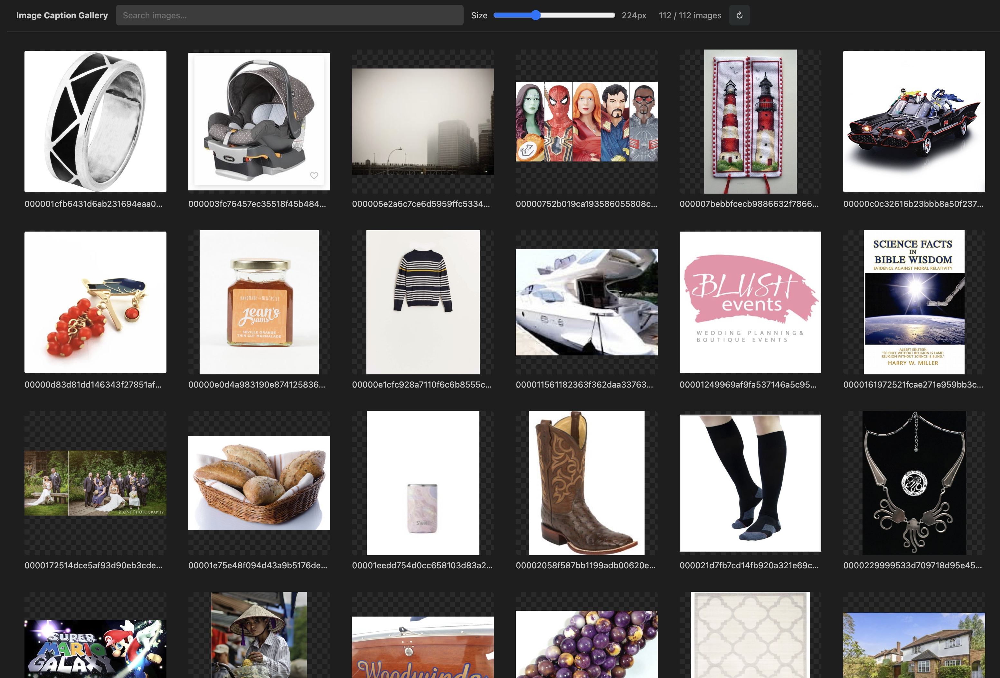
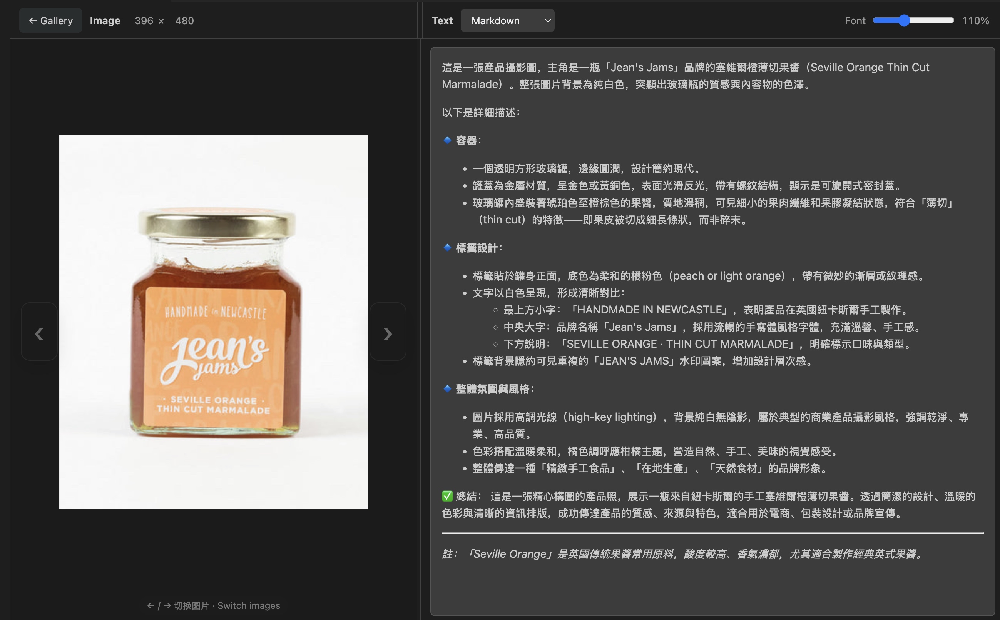
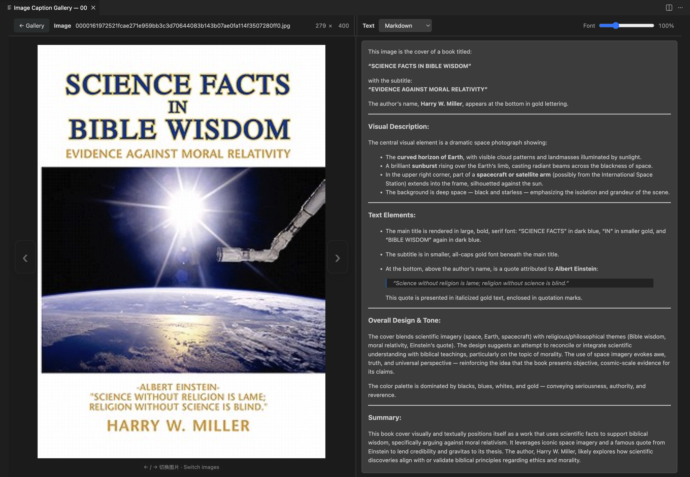

# Image Caption Gallery

[English](README.md) | [简体中文](README.zh-CN.md)

一个快速、本地优先的 VS Code 图文数据工具，让你无需离开编辑器就能浏览图片、视频数据集并编辑配套 Caption。

你可以把一个目录打开为可调节缩略图大小的 Gallery，点击任意图片或视频后，在左侧查看媒体、右侧阅读或编辑同名 `.txt` 文本。Caption 默认保持只读，并支持 Markdown、原始文本和格式化 JSON 三种显示方式。

## 界面预览

### Gallery 总览

<p align="center">
  
</p>

### 图片与 Markdown Caption

<p align="center">
  
</p>

### Caption 编辑状态

<p align="center">
  
</p>

## 主要功能

- 从 VS Code 资源管理器右键打开目录、图片或视频。
- macOS 使用 `Command+Option+G`（`⌘⌥G`），Windows/Linux 使用 `Ctrl+Alt+G` 快速启动。
- 递归发现 `.jpg`、`.jpeg`、`.png`、`.webp`、`.gif`、`.bmp`、`.avif`，以及 `.dng`、`.cr2`、`.cr3`、`.nef`、`.arw` 等相机 RAW 图片。
- 将 Gallery 缩略图大小从 96 px 连续调整到 480 px。
- 按文件名或相对路径搜索图片。
- 显式进入 Edit 模式后，可编辑已有的同名 `.txt` Caption，也可新建缺失的 Caption。
- 默认使用 Markdown 渲染，也可切换为 Raw 原始文本或格式化 JSON。
- 使用 `Command+S` / `Ctrl+S` 保存，使用 `Escape` 取消编辑。
- 草稿未保存时，切图、返回 Gallery 或隐藏 Text 都会先询问保存、放弃还是继续编辑。
- 保存前检查文件是否被外部程序修改，可选择覆盖、重新载入或继续编辑。
- 更新已有文件时尽量保留 UTF-8 BOM 与 LF/CRLF 换行格式。
- 拖动中间分隔线，自由调整 Image 与 Text 两栏宽度。
- 在 **设置 → 显示 Caption 文本** 中切换全宽纯浏览和文本阅读。
- 图片默认按当前可用宽度或高度完整显示，调整窗口或分隔线后会自动重新计算。
- 使用触控板捏合或 `Ctrl/Command + 滚轮` 将图片缩放到 25%–800%，默认响应更快，在设置中提供放大滑块和可点击复位的百分比。
- 放大后可用鼠标拖动或双指滑动查看细节，双击图片恢复默认完整视图。
- 在详情页文件名下方查看原图与预览分辨率，设置面板中也保留尺寸信息。
- 使用紧凑下拉框将 Caption 字体缩放到 70%–180%。
- 使用 `←` / `→` 键或图片两侧的半透明按钮切换图片。
- 使用 `Escape` 返回 Gallery，并保留搜索条件和缩略图状态。
- 支持本地工作区和 VS Code Remote SSH。
- 在扩展主机生成等比预览图，默认限制为 2048² 像素，减少 SSH 图片传输量。
- Gallery 与详情共用一个设置面板；全宽纯浏览模式不读取或渲染 Caption 文件。
- 在同一个 Gallery 混合浏览 MP4、WebM、MOV、AVI、MKV 等视频和图片，使用原生播放、进度、音量及全屏控制。
- 打开视频详情时按需加载，切换文件或返回 Gallery 时停止播放。

## 安装

直接从 VS Code Marketplace 安装：

```bash
code --install-extension xingfu-yi.image-caption-gallery --force
```

也可以从 [GitHub Releases](https://github.com/Xingfu-Yi/vscode-image-caption-gallery/releases) 下载最新的 `.vsix` 文件，然后在 VS Code 命令面板中运行 **Extensions: Install from VSIX...**。

使用 Remote SSH 时，需要把插件安装到远程扩展主机。如果在远程终端运行安装命令，请先把 `.vsix` 复制到服务器，并使用服务器上的文件路径。

## 使用方法

1. 在 VS Code 中打开包含图片、视频和可选 Caption 的目录。
2. 在资源管理器中右键点击图片、视频或目录，选择 **Image Caption Gallery**；也可以选中图片后直接按启动快捷键。
3. 在 Gallery 中调整缩略图大小或搜索图片。
4. 点击图片或视频，进入左侧媒体、右侧 Text 的并排预览界面。
5. 点击 **Edit** 编辑 Caption；用 `Command+S` / `Ctrl+S` 或勾号保存，用 `Escape` 或叉号取消。

如果同名 `.txt` 不存在，Edit 会打开一个空白草稿，保存时自动创建 UTF-8 文件。如果编辑期间文件被其他程序修改，插件会询问是覆盖、重新载入外部版本，还是继续保留当前草稿。

### 设置面板与小屏布局

Gallery 和详情顶栏都提供 **设置（Settings）** 入口。面板集中管理 Caption 显示、阅读格式、字号、图片与文本的布局和比例、图片放大、缩略图大小、预览清晰度、缩放速度，以及视频兼容模式和 FFmpeg 路径。各选项带有名称或说明；详情顶栏保留返回、文件名与尺寸摘要、编辑和设置，其余显示偏好放入面板。

设置即时作用于当前 Gallery 并在当前页记忆，不自动修改工作区设置。面板底部的 **VS Code 默认设置…** 可打开插件配置，修改新 Gallery 的默认值。SSH 下 FFmpeg 路径指服务器上的路径。界面设置文案跟随 VS Code 显示语言，支持中文和英文。

**自动布局** 在宽度小于 680 px 时将文本放到图片下方，也可手动选择左右或上下排列。面板可独立滚动，在很窄的窗口中铺满宽度。Escape 只关闭设置并恢复焦点，不退出当前媒体。Caption 草稿仍受“保存／放弃／继续编辑”保护。仅打开设置不会暂停视频；修改视频兼容配置会重新准备播放源。

### 预览分辨率与纯图片浏览

在 VS Code 设置中搜索以下配置，或写入 `settings.json`：

```json
{
  "imageCaptionGallery.maxPreviewResolution": 2048,
  "imageCaptionGallery.showCaption": true,
  "imageCaptionGallery.zoomSensitivity": 5
}
```

`maxPreviewResolution` 表示**总像素上限**，不是最长边：预览图的宽 × 高不超过配置值的平方。例如，4096 × 4096 会缩到 2048 × 2048，而 4000 × 1000 保持原尺寸。图片不放大、不裁剪，也不覆盖原文件。设为 `0` 则在详情中加载原图，网格缩略图仍使用小尺寸预览。修改分辨率配置会更新已打开 Gallery 的图片，并保留 Caption 编辑草稿。

使用 Remote SSH 时，预览图在**远程扩展主机**上生成，再传给客户端。缩略图与详情分别缓存；后台使用有数量上限的 CPU 解码器池，队列优先处理详情图片，只请求可见区域附近的缩略图。磁盘缓存采用 256 MiB LRU 上限，正在使用的文件受到保护，因此活跃图片可能使缓存暂时超过该上限。详情页文件名下方显示按 EXIF 方向校正后的原图与实际预览尺寸，设置面板中也保留尺寸信息。

超过上限的图片会编码为质量 85 的 WebP 预览，保留透明度和 GIF/WebP 动画；详情图片未超过上限时直接使用原文件。如果预览生成失败或超出处理资源限制，可在详情中点击 **Load original** 加载原图，避免自动传输超大文件。插件内置 WASM32 ImageMagick 引擎，服务器无需另装图像工具。

默认在扩展主机使用**可复用的多进程池**，Remote SSH 下就在服务器运行。打开 **设置 → 图片解码运行方式 / 图片解码并行数量**，可选择多进程或 Worker 多线程、自动或手动数量。两者都能利用 CPU 多核；进程隔离性更好，线程减少进程间数据复制，可能更快。VS Code 配置 `imageCaptionGallery.previewExecutionMode` 默认为 `"process"`，也可选 `"thread"`；`imageCaptionGallery.previewConcurrency` 默认为 `0`，按 CPU 与可用内存自动选择 1–4 个解码器（每个按约 512 MiB 预算）。手动可选 1–8，实际受 CPU 数量和总内存限制。并行主要减少多张图片之间的排队，不会把单张 RAW 的显影拆到多个核，也不加速网络读取；当前不使用 GPU。面板修改作用于此主机本次会话内的全部 Gallery，通过下方 VS Code 默认设置可保存本机或远程主机默认值。改变模式或数量时允许已运行任务完成，无人使用的任务会取消，解码器空闲 30 秒后释放；独立进程无法启动时自动回退到线程。

**设置 → 当前图片准备耗时** 分别显示主机排队、文件读取、解码／缩放／编码（冷启动包含解码器初始化）、缓存写入、资源加载和浏览器解码。**切换到绘制** 单独记录本次切图延迟，不与之前的预加载耗时混淆。JPEG 缩小时使用缩放解码；RAW 优先使用足够大的内嵌预览，否则完整显影。

当前图片请求进入主机队列后，立即准备 **左右各一张**，让空闲解码进程与当前图片的传输和浏览器解码重叠工作。切换到正在预加载的图片时，直接提升原任务，并开始准备它的新邻图。当前图片优先于邻图，邻图优先于网格缩略图。准备好的图片直接复用已解码元素；最近看过的图片使用 **最多七张、估算解码内存上限 128 MiB 的 LRU 缓存**，当前图受保护。超大原图或动画按需加载，每张估算 RGBA 超过 64 MiB 的邻图不保留预加载。慢切换时先显示目标已有缩略图，或保留上一帧并明确标注正在切换；超过 150 ms 才显示加载提示。首次加载和连续切图超过预加载进度时仍可能等待。

Caption 仅在显示时预读，独立于图片加载，并后台校验更新；不覆盖编辑草稿。图片修改时间、大小及预览设置变化会使缓存失效。快速切图取消无用任务，旧结果不会串图或串文本。隐藏面板、返回 Gallery 时释放邻图和历史缓存；视频仍按需加载。

将 `showCaption` 设为 `false`，新开的 Gallery 默认进入全宽纯图片模式。在 Gallery 或详情顶栏打开 **设置（Settings）**，使用 **显示 Caption 文本 / Caption text** 下的 **Caption: On / Off** 切换当前 Gallery 的状态。隐藏后不读取或渲染 Caption；重新显示时读取当前图片对应的最新文本。切换选择在当前 Gallery 内记忆，不修改工作区设置；新 Gallery 使用配置默认值。有未保存的 Caption 草稿时，隐藏 Text 前仍需选择保存、放弃或继续编辑。

### 大目录性能

Gallery 只渲染可见行及少量缓冲行。滚动时复用仍可见的卡片，并释放离开窗口的图片；打开详情或隐藏 Gallery 后会释放网格资源。缩略图最多同时加载 4 张。搜索会覆盖已发现的全部文件，并在短暂停止输入后执行；返回 Gallery 保留滚动位置。方向键、Home/End 和 Tab 可继续访问当前渲染区域以外的文件。

缩略图单独生成**静态 WebP，总像素不超过 512²**；`maxPreviewResolution` 更小时使用该值，不放大小图。动画缩略图显示第一帧，详情页保留动画播放。`maxPreviewResolution` 设为 `0` 时，**详情**使用原图，网格仍使用小尺寸缩略图，以限制传输和解码内存。不修改原始图片。

目录扫描每批最多返回 512 条文件记录，发现文件后即可开始浏览，关闭或刷新 Gallery 会取消之前的扫描。缓存命中和资源释放不再逐次排序整个预览缓存。

JPEG 缩略图会按目标尺寸解码，避免先展开整张大图再缩小；缩略图移除相机元数据，保留 ICC 色彩信息。小于等于 256 KiB 的 WebP 缩略图直接随响应传回，减少一次 SSH 资源请求。调度优先处理当前视口，按解码器数量保持 4–16 个在途请求，采用一套可见区域加载机制；失败或超时会释放队列名额。悬停可查看服务器排队、解码，以及消息往返与浏览器显示耗时。缓存可在重新打开或重启后复用。大型 PNG 使用有上限的 384 MiB 像素缓存，自动并行数量按每个解码器约 768 MiB 预算，为 WASM 和输入缓冲预留空间。

安装开发依赖后，可运行 `npm run benchmark:thumbnails -- /图片目录 12`，测量首次、缓存和重启后的缩略图生成耗时，不修改源文件；此数据不包含 SSH 传输和浏览器绘制。`node test/serveGalleryHarness.cjs` 使用真实扩展链路和 287 张合成大 JPEG 验证浏览器显示及滚动。

### 相机 RAW 与缩放灵敏度

详情页文件名下方直接显示按方向旋转后的原图分辨率，以及缩小后的实际预览分辨率，无需打开设置。TIFF 类 RAW 有足够清晰的相机内嵌 JPEG 时，优先复用并按目标尺寸解码以减少等待；不会放大小缩略图冒充所选清晰度。内嵌预览缺失、损坏、尺寸不足或比例不符时，仍回退 LibRaw 完整解码；原始分辨率请求始终完整解码。相机内嵌预览使用相机自身的成像风格，原文件保持不变。

需要完整 RAW 显影时，在扩展主机通过内置 LibRaw 解码，采用相机白平衡和 sRGB 输出。支持 `.dng`、`.cr2`、`.cr3`、`.crw`、`.nef`、`.nrw`、`.arw`、`.raf`、`.orf`、`.rw2`、`.pef`、`.srw` 等相机格式；具体机型和压缩变体取决于内置解码器。没有文件头、需要另行提供尺寸和排列信息的科研或传感器 `.raw` 数据不在此次支持范围内。

RAW **始终转换为浏览器可显示的预览图**，即使图片小于像素上限，或 `maxPreviewResolution` 设为 `0`。对于 RAW，**Load original** 表示生成原始分辨率的解码图，不会把无法直接显示的传感器文件交给浏览器。原文件保持不变。

`zoomSensitivity` 范围为 `0.5`–`10`，默认 `5`：轻微捏合的缩放响应是 0.2.0 的 5 倍。设为 `1` 可恢复原来的响应速度，修改后对已打开的 Gallery 立即生效。插件统一处理滚轮的像素、行、页单位，并限制单次跳变量。设置面板提供放大滑块和当前百分比，点击百分比或双击图片可恢复完整适配视图；普通双指滚动仍用于平移放大后的图片。

### 图片全屏浏览

点开图片后，点击详情顶栏的 **全屏**，或按 **F**。窄屏中也会保留“全屏”文字。在浏览器里再点击 **进入全屏**（或按 **F**），进入真正全屏：屏幕只显示完整图片与必要的黑边，不保留 VS Code 或浏览器界面。这第二次操作是浏览器的用户手势要求。横图、竖图均保持比例完整显示，不裁剪。**← / →** 左右切图且保持全屏，**Home / End** 跳到首张／末张，也支持触屏左右滑动。空闲两秒自动隐藏工具栏、箭头和鼠标，操作时恢复；**Esc** 退出全屏后留在浏览器。浏览器内双击切换全屏；Gallery 内双击仍用于重置图片缩放。

也可以从 **设置 → 图片 → 图片全屏浏览** 打开当前图片；在 Gallery 网格中使用此入口，会从当前搜索结果的第一张图片开始。浏览器沿用该图片顺序并跳过视频，不读取 Caption，不改变 Gallery 中的文本显示状态或未保存编辑。沿用打开时选择的预览清晰度，包括原图模式和 RAW 解码；要换清晰度，在 Gallery 调整后重新打开浏览器即可。

左右邻图会提前在服务器生成预览、传输并在浏览器解码。浏览器最多保留七张图片，估算解码内存上限 128 MiB，保护当前显示图片，并在后台检查文件是否更新。超预算的原图或动画按需加载，不降低所选画质或改为静态图片；首次冷加载仍可能需要处理与传输时间。SSH 复用现有私有转发，关闭 Gallery 后仍可浏览，断开 SSH 或关闭 VS Code 会停止服务；连续 30 分钟无活动的会话会过期。

### 视频浏览

支持 MP4、WebM、MOV、M4V、AVI、MKV、MPG/MPEG、WMV、3GP、MTS/M2TS、OGV、VOB、FLV，与图片混合显示。扫描目录只读取文件记录；视频卡片进入可见区域后，仅提取并加载**第一帧的小尺寸 JPEG**，叠加播放标识和格式标签，不在网格中加载视频。首帧提取需要 FFmpeg，结果会缓存。小尺寸 JPEG 直接随结果消息传送，省去 Remote SSH 的第二次资源读取；仅由 Gallery 的可见区域调度控制加载。卡片显示准备中或失败状态，避免一直停留在无说明的占位图。悬停已加载缩略图可查看缓存命中、图片大小、主机排队／提取耗时，以及估算的消息往返与显示耗时；刷新可重试失败项。

视频默认暂停，使用原生播放器的播放／暂停、完整时间轴拖动和音量控制。详情页获得焦点时可按空格播放／暂停，焦点位于播放器时保留原生快捷键。视频共用 TXT Caption 编辑和 Caption 开关。切换文件会释放视频并取消无人使用的请求；隐藏 Gallery 会暂停播放和兼容片段请求，打开 Settings 保留播放状态。

详情顶栏的 **Caption** 快捷开关（`C`）适用于图片和视频。关闭后媒体占满可用区域，不读取 Caption；恢复后读取对应文件的最新文本。有未保存编辑时仍使用“保存／放弃／继续编辑”流程。

视频顶栏的 **全屏**（`F` 或双击）会打开独立浏览器播放器，继承当前进度、画质、倍速、音量和静音状态，打开成功后暂停 Gallery。浏览器中再点击 **继续播放并全屏** 进入真正全屏，这是浏览器要求的额外用户操作。播放时空闲两秒隐藏控制栏，操作时重新出现；`Esc` 退出后留在浏览器，Gallery 不自动恢复播放。Caption 草稿继续保留在 Gallery。

VS Code 的扩展 Webview 禁用了视频原生全屏（[官方记录](https://github.com/microsoft/vscode/issues/165073)）。**Settings → 视频 → 观看区域 → 铺满面板** 保留在 Gallery 内，临时隐藏 Caption，`Esc` 恢复原布局；它与浏览器全屏是两个不同入口，不会修改 VS Code 的布局设置。

浏览器对支持的原文件按字节范围读取，包括 H.264/AAC 的 MP4/MOV。需要缩放或兼容时，使用安装包内的 **HLS.js 1.7.3** 和按需生成的 **四秒 H.264/AAC MPEG-TS 片段**，不依赖 CDN，也不转换整个视频。浏览器兼容路径需要 FFmpeg 提供 `libx264` 和 AAC；Gallery 内仍使用 VP8/Vorbis。私有回环服务通过 Remote SSH 转发。浏览器会话独立于 Gallery，关闭 Gallery 后仍可播放，连续 30 分钟无活动后失效；关闭 VS Code 或断开 SSH 会中断播放。

Gallery 对分片严格串行追加，中止或关闭不会被当作加载成功，拖动后的旧结果不再提交。兼容流出错时最多自动重建一次，保留进度和状态；持续失败则在画面下方提供原文件入口。具体媒体错误、分片编号和耗时可在 **输出 → Image Caption Gallery · Video** 查看。

**Settings → 视频 → 播放倍速** 可选择 0.25×–4×，立即生效，无需重新加载。当前 Gallery 会在拖动进度、切换视频时保留倍速；原生播放器中修改的倍速也会同步到设置。

播放时按当前位置读取远端内容，无需先处理完整视频：

- **原生兼容视频：**通过 HTTP Range 读取所需字节，开放结束位置的范围请求每次最多返回 4 MiB。拖动进度条时，由播放器请求对应位置。
- **兼容播放：**`imageCaptionGallery.videoCompatibility` 默认为 `"auto"`。FFprobe 读取编码和时长等元数据，不兼容的视频使用 MediaSource 播放 **4 秒一段的 VP8/Vorbis WebM**，由扩展主机上的 FFmpeg 按请求生成。暂停打开时只准备当前片段；播放时最多预取后续两个片段，内存仅保留当前位置附近的少量片段。拖动后直接请求目标片段，取消过期任务，不转换中间内容，也不生成完整兼容副本。

例如 VS Code 的 Webview 不支持 AAC 音轨，H.264/AAC 的 MP4 会使用兼容片段。参见 [VS Code 官方媒体兼容说明](https://code.visualstudio.com/api/extension-guides/webview#supported-media-formats)。**Convert with FFmpeg** 同样使用短片段；兼容播放失败时可用 **Play original video** 尝试原生播放。首次访问未缓存片段仍可能短暂等待服务器解码和传输。

播放器下方提供 **原画、2K、1080p、720p** 四档画质，**默认取原视频与 2K 中较低的分辨率**，不放大小视频。2K 指最高 2560 × 1440；1080p 为 1920 × 1080，720p 为 1280 × 720，竖屏交换宽高，其他比例保持等比缩放。也可在 **Settings → 视频画质** 或 `imageCaptionGallery.videoPreviewMaxHeight` 中设置：`0` 为原画，`1440` 为 2K（默认），另有 `1080` 和 `720`。原画保留源分辨率；编码或音轨不兼容时仍会按需转换短片段。兼容原文件在超过所选画质时也只转换所需片段，降低 CPU 和 SSH 流量；从不等待整段转换。显式“直接播放原文件”会绕过画质限制，选择画质会恢复自动模式。

切换画质保留进度、倍速、音量和暂停 / 播放状态，不影响 Caption 草稿。每个 Gallery 保留自己的画质选择，新 Gallery 使用 VS Code 默认设置；界面切换不会修改工作区配置。旧版 Gallery 保存的兼容预览默认值会迁移到新的默认设置；旧版 480 / 2160 配置分别迁移为 720p / 2K。顶栏保留原视频尺寸，下方显示实际播放尺寸；小视频会标注“原画”。播放器上方不再常驻兼容提示，加载状态、错误和回退按钮显示在画面下方，详细信息可在设置中查看。图片总像素限制和捏合缩放仍只作用于图片。

需要在**扩展主机**安装 **FFmpeg 和 ffprobe**：本地目录安装在本机，Remote SSH 则安装在**远程服务器**。兼容播放需要 `libvpx` 和 `libvorbis`（或原生 `vorbis`）编码器，**不再依赖 `libmp3lame`**。插件会检查实际可用编码器；使用默认 `ffmpeg` 命令时，也会尝试常见系统路径，避免 PATH 中功能不全的构建遮蔽可用的系统构建。VSIX 不内置或自动下载这些工具。缺少工具时仍尝试原生播放 MP4/WebM/MOV/M4V，卡片保留播放标识，兼容处理会显示明确错误。

```json
{
  "imageCaptionGallery.videoCompatibility": "auto",
  "imageCaptionGallery.videoPreviewMaxHeight": 1440,
  "imageCaptionGallery.ffmpegPath": "ffmpeg"
}
```

`ffmpegPath` 可填写 PATH 中的命令名或可执行文件绝对路径，`ffprobe` 需位于旁边，含空格的路径无需额外加引号。SSH 请在 **Remote** 设置中配置服务器路径。`videoCompatibility` 设为 `"native"` 可跳过编码检测和兼容处理，原生播放失败时仍可手动启用兼容播放。

媒体服务仅监听扩展主机的回环地址，使用可撤销的随机资源地址，Remote SSH 下由 VS Code 私下转发，无需手动开放公网端口。播放同时最多运行两个 FFmpeg 任务；首帧提取使用独立、按 CPU 限制的 1–4 个任务，避免被其他 Gallery 的播放持续占满。首帧解码、缩放和编码各使用单线程，重复任务合并。先用有限探测快速提取，特殊容器失败时回退一次常规探测，不扫描视频挑选代表画面。缓存命中在重启后也会跳过 FFmpeg 检测。已生成片段和首帧存于独立的 **512 MiB LRU 缓存**，按源文件路径、修改时间、大小、工具和播放配置区分；可见网格中的首帧在释放前受保护。原视频不修改。兼容播放使用第一条视频和音频流，不保留内嵌字幕，目前不自动调整码率。

### 快捷键

| 操作 | macOS | Windows / Linux |
| --- | --- | --- |
| 打开 Image Caption Gallery | `Command+Option+G`（`⌘⌥G`） | `Ctrl+Alt+G` |
| 编辑时保存 Caption | `Command+S` | `Ctrl+S` |
| 取消 Caption 编辑 | `Escape` | `Escape` |
| 上一个 / 下一个文件 | `←` / `→` | `←` / `→` |
| 缩放图片 | 触控板捏合或 `Command + 滚轮` | 触控板捏合或 `Ctrl + 滚轮` |
| 显示／隐藏 Caption | `C` | `C` |
| 打开图片／视频浏览器全屏 | `F` | `F` |
| 退出铺满面板／浏览器全屏 | `Escape` | `Escape` |
| 播放／暂停视频（详情页获得焦点时） | `Space` | `Space` |
| 平移放大后的图片 | 拖动或双指滑动 | 拖动或双指滑动 |
| 恢复图片视图 | 双击图片 | 双击图片 |
| 返回 Gallery | `Escape` | `Escape` |


## 数据集目录格式

Caption 文件需要与图片或视频使用相同的主文件名：

```text
dataset/
├── image-001.jpg
├── image-001.txt
├── image-002.png
├── image-002.txt
├── clip.mp4
└── clip.txt
```

## 兼容性

- Visual Studio Code 1.85.0 及以上版本。
- 支持本地工作区和 VS Code Remote SSH。
- 图片引擎跨平台，VSIX 安装包不区分操作系统；视频兼容转换使用扩展主机上的可选 FFmpeg/ffprobe。

## 隐私

Image Caption Gallery 在 Text 栏可见时读取 Caption，仅在你明确保存时修改 Caption。打开的视频通过私有回环服务和 VS Code SSH 转发按需读取；图片预览、视频首帧及请求的兼容片段缓存在扩展主机的扩展存储目录，不修改原始媒体。插件不会将数据集上传到外部服务，也不包含遥测功能。

## 本地开发

```bash
npm install
npm run compile
```

使用 VS Code 打开本仓库并按 `F5`，即可启动 Extension Development Host。`npm run compile` 同时将 WASM32 引擎和许可证复制到 `dist/vendor`；`npm run watch` 会先准备引擎再启动 TypeScript 监听。

运行 `npm run preview:harness` 可根据真实扩展 HTML 重新生成静态预览。运行 `npm test` 验证尺寸计算、图片解码、动画、缓存与 Worker、远程 URI 和界面交互。可通过本地 HTTP 服务打开 `test/webviewHarness.html?count=100000` 压测十万条图片记录，或打开 `test/webviewHarness.html` 手动预览界面，内含 `test/fixtures` 下生成的 VP8/Vorbis WebM 测试视频。安装 FFmpeg/ffprobe 后，测试还会验证实际字节范围、首帧、AAC 兼容片段、远距离拖动、取消、MediaSource 缓冲和缓存回收。生成预览后运行 `node test/serveStreamingHarness.cjs`，可在浏览器实际验证合成的 40 秒视频时间轴；网址添加 `?videos=8` 可验证 8 个独立视频的首帧提取和消息内嵌传输。测试媒体不会包含在 VSIX 中；原生播放不强制依赖 FFmpeg。运行 `npm run benchmark:previews` 可比较 6 张合成 JPEG 的准备时间；编译后也可运行 `node test/previewBenchmark.cjs /图片路径`，使用新缓存测试本机图片。应在同一机器、同一文件上比较；合成测试的吞吐量不代表特定 RAW 文件的耗时。编译后运行 `node test/videoPosterBenchmark.cjs /视频文件夹` 可使用临时缓存比较最多 8 个视频的首帧冷启动、缓存命中及重启后命中耗时；不修改原视频，也不导出缩略图。运行 `npm run package` 生成跨平台本地 VSIX。内置图像引擎会增大安装包，运行时无需下载依赖。

## 后续计划

- 支持更多可配置的 Caption 与元数据文件命名方式。
- 提供更丰富的排序和筛选能力。
- 增加图片元数据和数据集质量检查工具。

## 参与贡献

欢迎提交 Issue 和 Pull Request。请尽量保持改动范围清晰，并说明在本地与 Remote SSH 环境中的测试方式。

## 开源协议

[MIT](LICENSE)
